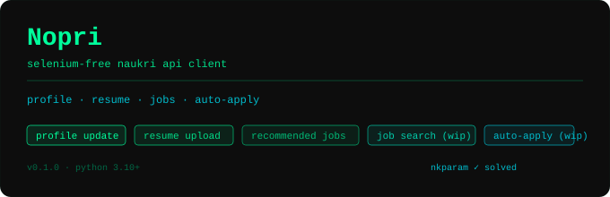

<p align="center">
  
</p>

# Noperi

A lightweight and Selenium-free Python API client for Naukri.com, designed to help you update your profile, upload your resume, search jobs, and apply to jobs (easy apply) programmatically.

---

**Status:** 🟢 Working (Last tested: July 2026)

---

## ✨ Features

| Feature | Status |
|---|---|
| Login & session management (Bearer token) | ✅ Working |
| Resume upload (PDF) | ✅ Working |
| Profile update (headline, name, summary) | ✅ Working |
| Recommended jobs feed | ✅ Working |
| `nkparam` token harvester (Selenium utility) | ✅ Working |
| `nkparam` token generator (pure API, no Selenium) | ✅ Working |
| Job search (`/jobapi/v3/search`) | ✅ Working |
| Job details  (`jobapi/v1/job/`) | ✅ Working |
| One-click job apply | ✅ Working |
| Job questionnaire while applying| ✅ Working Partially (harcoded answer) |
| OTP login/MFA | ✅ Working |


> **Updated on April 13 2026**  
> **No Selenium required** for core features.  
> The `nkparam` token is generated via API.  
> Selenium-based harvester is kept only as a backup utility.

> **No Selenium required** for features 1–4. The Selenium script is only needed as a helper to harvest fresh `nkparam` tokens for the search endpoint.

---

## 🗂️ Project Structure

```
naukri-api-client/
├── main.py                     # Entry point — demo of all features
├── nkPool.txt                  # Pool of captured nkparam tokens
├── .env                        # Credentials 
├── src/
│   ├── client/
│   │   ├── naukri_client.py    # Core auth + profile + resume client
│   │   ├── job_client.py       # Recommended jobs + search + apply
│   │   └── session.py          # requests.Session factory
│   ├── config/
│   │   └── constants.py        # URLs, regex patterns, app IDs
│   ├── exceptions/
│   │   └── exceptions.py       # Custom exception classes
│   ├── models/
│   │   └── models.py           # Dataclasses: Job, NaukriSession, etc.
│   └── utils/
│       ├── extractors.py       # HTML / JS parsing helpers
│       └── request_helper.py   # Exponential-retry decorator
        ├── get_Nkparam.py      # Selenium helper to harvest nkparam tokens
        ├── nkparam_generator.py   #generate nkparam tokens 
```

---

## ⚠️ IP & Hosting Advice

Naukri fingerprints IPs for every request. Many cloud providers trigger MFA or get blocked.

**Avoid:**
- Azure (all regions)
- GitHub Actions / CI
- Some Google Cloud regions
- Datacenter IP ranges

**Works:**
- AWS (EC2 with Elastic IP)
- Home broadband / personal IP (best)
- Mobile hotspot (testing)
- Residential proxy

**Note:**
- Sessions are IP-bound — changing IP will invalidate login
- Avoid GitHub Actions completely (IP pool is flagged)


## ⚙️ Installation

**Requirements:** Python 3.10+

```bash
git clone https://github.com/vairam-exe/jobember.git
cd jobember
pip install -r requirements.txt
```

Create a `.env` file in the project root:

```env
USERNAME=your_naukri_email@example.com
PASSWORD=your_naukri_password
```

---
## 🚀 Quick Start 
        you can simply run `main.py` also

        ```python
        from src.client.naukri_client import NaukriLoginClient
        from src.client.job_client import NaukriJobClient
        from dotenv import load_dotenv
        import os
        import time

        load_dotenv()

        # 1. Login
        client = NaukriLoginClient(os.getenv("USERNAME"), os.getenv("PASSWORD"))
        client.login()

        # 2. Upload resume
        client.update_resume("path/to/your_resume.pdf")

        # 3. Update profile headline
        client.update_profile(headline="Backend Engineer | Python · Node.js · AWS")

        # 4. Update profile summary
        client.update_profile(summary="Experienced engineer with 2+ years building scalable APIs.")

        # 5. Job client
        jc = NaukriJobClient(client)

        # 6. Fetch recommended jobs
        jobs = jc.get_recommended_jobs()
        for job in jobs:
            print(job.title, "—", job.company)

        # 7. Search jobs
        jobs = jc.search_jobs(keyword="Node.js developer", location="Hyderabad", experience=2)

        # 8. Apply to jobs (easy apply)
        for job in jobs:
            mandatory = job.tags[:2] if job.tags else []
            optional  = job.tags[2:] if len(job.tags) > 2 else []

            try:
                result = jc.apply_job(
                    job,
                    mandatory_skills=mandatory,
                    optional_skills=optional,
                    source="recommended"
                )

                job_result = (result.get("jobs") or [{}])[0]

                # Skip jobs with questionnaire
                if job_result.get("questionnaire"):
                    print("Skipped (questionnaire required):", job.title)
                    continue

                print("Applied:", job.title)

            except Exception as e:
                print("Failed:", job.title, "|", e)

            time.sleep(2)


---

## 📖 API Reference

### `NaukriLoginClient`

| Method | Description |
|---|---|
| `login()` | Authenticates and stores the Bearer token + session cookies |
| `update_resume(file)` | Uploads a PDF resume; accepts a file path (`str`) or a file-like object |
| `update_profile(headline, name, summary)` | Updates one or more profile fields (all arguments are optional) |
| `fetch_profile_id()` | Returns your Naukri profile ID (cached after first call) |
| `get_form_key2()` | Extracts the internal `formKey` from Naukri's JS bundle (cached) |

### `NaukriJobClient`

| Method | Description |
|---|---|
| `get_recommended_jobs()` | Returns a list of `Job` objects personalised to your profile |
| `search_jobs(keyword, location, page, experience, ...)` | Returns job results using the search endpoint |
| `apply_job(job)` | Applies to a job programmatically |

### `Job` model

```python
@dataclass
class Job:
    job_id:      str
    title:       str
    company:     str
    location:    str
    experience:  str
    salary:      str
    posted_date: str
    apply_link:  str
    description: str
    tags:        list[str]
```

---

## 🔑 The `nkparam` Problem (and Current Solution)

Naukri's job-search endpoint (`/jobapi/v3/search`) requires a request header called `nkparam`.  
This is not just a random token — it is essentially an **encrypted/signature key** generated using:
- current timestamp (time-based salt)
- session-related data
- page/context-specific parameters

The logic exists inside Naukri’s obfuscated JavaScript bundle, which makes it hard to reverse directly.

If `nkparam` is missing or invalid, the API returns `403 Forbidden`.

---

### ✅ Current Solution

We now generate `nkparam` directly via API logic (no browser required).


---

### 🧰 Fallback (Optional)

A Selenium-based harvester is still available as a backup:

**`nk_param_getter.py`**
- Opens Chrome
- Captures network requests
- Extracts valid `nkparam`
- Stores in `nkPool.txt`


---

## 🤖 Automated Job Application Agent

For a fully automated, AI-powered job application workflow, use:

```bash
python apply_agent.py
```

The agent is built on top of `NaukriLoginClient` and `NaukriJobClient`, so all authentication, session management, cookies, and token handling are already taken care of automatically.

---

### ✨ What the Agent Does

The workflow runs end-to-end automatically:

1. Logs into Naukri using your `.env` credentials
2. Searches jobs using curated backend-focused keywords
3. Scores each job using an AI model (`OpenAI`)
4. Automatically applies to jobs that pass the score threshold
5. Handles basic job questionnaires using predefined answers
6. Skips external company-site applications
7. Prevents duplicate applications using a local CSV log
8. Displays a colored terminal dashboard with live progress

---

### ⚙️ Prerequisites

Add your OpenAI API key to the `.env` file:

```env
OPEN_API_KEY=your-openai-api-key
```

Your `.env` should now look like:

```env
USERNAME=your_naukri_email@example.com
PASSWORD=your_naukri_password
OPEN_API_KEY=your-openai-api-key
```

---

### 🧠 Default Search Strategy

The agent fetches jobs using curated backend-development queries such as:

- Node.js Developer
- Python Backend Developer
- Backend Engineer
- API Developer
- Full Stack Developer

It also filters using:
- Experience level
- Job freshness
- Multiple result pages

---

### 🔧 Configuration

You can customize the behaviour directly inside `apply_agent.py`:

| Variable | Purpose |
|---|---|
| `BQUERIES` | List of job search keywords |
| `EXPERIENCE_LEVELS` | Experience filters |
| `PAGES` | Number of search-result pages |
| `JOB_AGE` | Max age of jobs to consider |
| `SCORE_THRESHOLD` | Minimum AI score required before applying |

---

### 📂 Application Tracking

The agent keeps track of already-applied jobs using:

```bash
applied_jobs.csv
```

This ensures:
- No duplicate applications
- Safe repeated runs
- Persistent local history

---

### 🖥️ Terminal Dashboard

The agent displays a live terminal dashboard showing:

- Login status
- Jobs fetched
- AI evaluation score
- Apply success/failure
- Questionnaire detection
- Final application summary

Example:

```text
[FETCH] Backend Engineer — Hyderabad
[AI SCORE] 8.7/10
[APPLY] Success
```

---

 External company-site applications | ❌ Skipped intentionally |

---

### 💡 Example Workflow

```bash
python apply_agent.py
```

Typical flow:

```text
Login Successful
Fetching Jobs...
Scoring with AI...
Applying...
Saved to applied_jobs.csv
Run Complete
```

---

## 🧠 Jev-Powered Scoring (resume-driven)

`jev_apply_agent.py` is a second, independent agent that scores jobs with
**Jev** — TypeSafe AI's System One model — instead of an LLM prompt. It coexists
with `apply_agent.py`; nothing in the older agent was modified.

Jev doesn't generate text. You send it a `state` (your resume + one job posting)
and a set of typed **questions**, and it returns typed answers with calibrated
probabilities and confidence. Nothing needs parsing, and it cannot hallucinate a
malformed payload. It answers in ~70–500 ms at $0.042/MTok of input with **free
output tokens**, which works out to roughly **$0.0001 per job scored**.

### Why the resume drives the model

The older scorer hardcoded a Node.js/Python candidate and its rubric rated
"Java + Spring only" at **0–15**. The actual resume is Java 17 / Spring Boot /
React, so the old filter scored the candidate's own stack at nearly zero.

`src/client/resume_profile.py` extracts the PDF and turns it into the `candidate`
block sent with every request, so the model's view of you can never drift from
the file. Edit the resume, and the next run re-scores everything automatically
(the cache is keyed by the resume's hash).

### The eight questions

One request per job carries all eight; Jev evaluates them in parallel.

| Question | Type | Purpose |
|---|---|---|
| `is_developer` | Noul | Is this a role that writes application code? |
| `is_support_role` | Noul | Support / helpdesk / L1-L2 / BPO / maintenance? |
| `role_family` | Choice | backend / fullstack / frontend / mobile / data / devops / support / qa / other |
| `matches_resume_stack` | Noul | Do the required skills overlap your core stack? |
| `skill_overlap` | Score (0-4) | **40% weight** — how much the stacks overlap |
| `experience_fit` | Score (0-4) | 15% — your years vs the years demanded |
| `seniority_fit` | Score (0-4) | 10% — junior-mid vs principal/staff |
| `should_apply` | Score (0-4) | **30% weight** — holistic fit |

```text
score = 100 × (0.40·skill_overlap + 0.15·experience_fit
             + 0.10·seniority_fit + 0.30·should_apply) / 0.95
score += 5  if the job was posted within a day
```

Weights live in `src/client/jev_matcher.py`, not in a prompt — tune a coefficient
and the next run reflects it.

### Strict gates (all must pass)

Naukri allows **50 applications per rolling 24h per account**, and manual and
bulk applies draw from the same pool. Applying is the scarce resource; scoring is
nearly free. So the agent scores far more jobs than it applies to, then spends the
budget on the best ones.

| Gate | Threshold |
|---|---|
| `is_support_role` | ≤ 0.20 |
| `is_developer` | ≥ 0.75 |
| `matches_resume_stack` | ≥ 0.70 |
| `role_family` | backend or fullstack |
| `skill_overlap` level | ≥ 3 of 4 |
| `should_apply` level | ≥ 3 of 4 |
| confidence | ≥ 0.60 |
| composite score | ≥ 75 |

Support / QA / helpdesk / maintenance / BPO titles are also rejected by regex
before a single token is spent.

**No company blacklist by default.** The older pipeline vetoed Infosys, Wipro,
TCS, Accenture, Cognizant and friends. On a live run that dropped ~40 roles whose
titles were exactly the candidate's stack (`Java Spring Boot Microservices @
Infosys`, `Java Full Stack Developer @ Infosys`, 18 near-identical
`Application Developer @ Accenture` postings). Whether a services company is a
worthwhile employer is a judgement, not a regex, so Jev scores the role on its
merits and only names you list in `JEV_VETO_COMPANIES` are excluded. The override
is applied per-instance, so `apply_agent.py` keeps its original behaviour.

### Quota enforcement

`src/client/quota.py` reads Naukri's own application history — so applies you made
on the website or your phone are counted too, not just ones this agent made. It
takes the larger of that and the local CSV ledgers:

```text
used      = max(naukri_history_24h, local_ledger_24h)
remaining = 50 − used − 5      # 5 held back for manual applies
```

The agent re-reads the history every 10 applications, so crossing a 24h boundary
or applying manually mid-run can't push you past the cap.

### Usage

```bash
python3 jev_apply_agent.py --quota-only    # report remaining quota, then exit
python3 jev_apply_agent.py --dry-run       # score + show everything, apply nothing
python3 jev_apply_agent.py                 # live run
python3 jev_apply_agent.py --limit 5 --threshold 80
```

**Always run `--dry-run` first** and read the table before letting it apply.

### Configuration (`.env`)

| Variable | Default | Meaning |
|---|---|---|
| `JEV_API_KEY` | — | TypeSafe key (`TYPESAFE_API_KEY` also accepted) |
| `JEV_MODEL` | `jev-latest` | Model name; see `GET https://api.typesafe.ai/v1/models` |
| `JEV_MIN_APPLY_SCORE` | `75` | Composite threshold to spend an application |
| `JEV_RESUME_PATH` | `resume.pdf` | Resume PDF used to build the candidate profile |
| `NAUKRI_COOKIE` | — | `nauk_at=...` token; persisted to `.naukri_session.json` after first use |
| `JEV_VETO_COMPANIES` | *(empty)* | Companies to veto anyway, e.g. `accenture,infosys`. Empty means none |

### Files

| Path | Role |
|---|---|
| `jev_apply_agent.py` | Orchestrator (fetch → score → apply) |
| `src/client/jev_client.py` | TypeSafe HTTP client with retry/backoff |
| `src/client/resume_profile.py` | PDF → candidate state, cached by SHA-1 |
| `src/client/jev_matcher.py` | The eight questions, weights and gates |
| `src/client/quota.py` | Rolling 24h quota accounting and dedupe |
| `src/client/session_store.py` | `nauk_at` persistence, JWT expiry, browser harvest |
| `src/utils/console.py` | Shared terminal rendering |

Generated at runtime (gitignored): `resume_profile.json`, `jev_score_cache.json`,
`jev_applied_jobs.csv`, `.naukri_session.json`, `.chrome-naukri-profile/`.

### Tests

```bash
python3 src/tests/test_quota.py          #  7 tests - quota maths + timestamp parsing
python3 src/tests/test_jev_matcher.py    # 17 tests - weights, gates, cache
python3 src/tests/test_session_store.py  #  6 tests - token parsing, expiry, priority
```

All run fully offline with a fake Jev client — no API key or network needed.

### Troubleshooting

| Symptom | Cause / fix |
|---|---|
| `validRequest:false` + `captchaSiteKey` on login | Naukri captcha-gates token minting on both `/v1/login` and `/v1/otp`. Use `--refresh-browser --show-browser`, or paste `nauk_at` once via `NAUKRI_COOKIE` / `--cookie`. It is then persisted for the rest of the hour |
| `SESSION EXPIRED` (exit 3) | The saved `nauk_at` passed its 60-minute `exp`. Run `--refresh-browser --show-browser` |
| `Session rejected: ... 401` | Token expired *despite* looking valid, or it was issued to a different IP (cookies are IP-bound). Refresh from the same network |
| Nothing is eligible | Lower `--threshold`, or check the resume PDF has a text layer |
| `JEV ERROR ... 401` | Bad/rotated key |
| `Could not extract text from the resume` | Scanned PDF — export with a text layer |

### Working around the captcha-gated login

Naukri captcha-gates **token minting itself**. Verified live:

| Request | Result |
|---|---|
| `GET https://www.naukri.com/` | `200` — IP is fine |
| `POST /central-login-services/v1/login` | `{"validRequest":false,"captchaSiteKey":...}` |
| `POST /central-login-services/v1/otp` | same 403 + `captchaSiteKey` |
| authenticated history call | `200`, sets `_t_ds`/`J`/`ak_bmsc` but **no new `nauk_at`** |

That last row matters: the session does **not** slide, so the JWT's 60-minute
`exp` is absolute and cannot be extended by using the API. It also rules out an
IP block, a fingerprint problem and a wrong password. It breaks `main.py`,
`apply_agent.py` and `updateDaily.py` alike, since they share `NaukriLoginClient`.

So a token has to come from a browser. The agent makes that as cheap as possible.

**1. Harvest it automatically (recommended)**

```bash
# First time: opens a visible Chrome using a dedicated profile
python3 jev_apply_agent.py --refresh-browser --show-browser
#   -> log in to naukri.com in that window, then the token is saved

# Later: headless, no interaction needed if the profile is still signed in
python3 jev_apply_agent.py --refresh-browser
```

The dedicated profile (`.chrome-naukri-profile/`, gitignored) is separate from
your everyday Chrome, so it never fights your normal browsing session.

**2. Or paste one once**

```bash
python3 jev_apply_agent.py --quota-only --cookie 'nauk_at=<paste from DevTools>'
# or put NAUKRI_COOKIE=nauk_at=... in .env
```

**The token is then persisted** to `.naukri_session.json` (mode `0600`,
gitignored), so every run inside the same hour needs no cookie at all. Resolution
order is `--cookie` → `NAUKRI_COOKIE` → saved session, and expired values are
skipped so a stale `.env` entry can never shadow a valid saved session.

**Exit codes** (handy for cron/alerting):

| Code | Meaning |
|---|---|
| `0` | success |
| `2` | configuration/key problem, or auth was rejected |
| `3` | session expired — needs a browser refresh |

The agent also validates the token with one tiny history request before anything
else, so a dead session fails in ~1s instead of mid-run.

---

## ⚠️ Disclaimer

This project is intended for personal automation of your **own** Naukri account. Use responsibly and in accordance with [Naukri's Terms of Service](https://www.naukri.com/termsAndConditions). The authors are not affiliated with Naukri / InfoEdge India Ltd.

---

## 🛣️ Roadmap

- [x] Complete job-search endpoint integration
- [x] Complete one-click job-apply flow

- [ ] Add async support (`httpx` / `aiohttp`)
- [ ] CLI interface

---

## 🤝 Contributing

Pull requests are welcome!
OTP/MFA login is now fully supported. The main area that could use help is **refactoring and cleanup** — improving code structure and formatting without breaking existing functionality.

---
